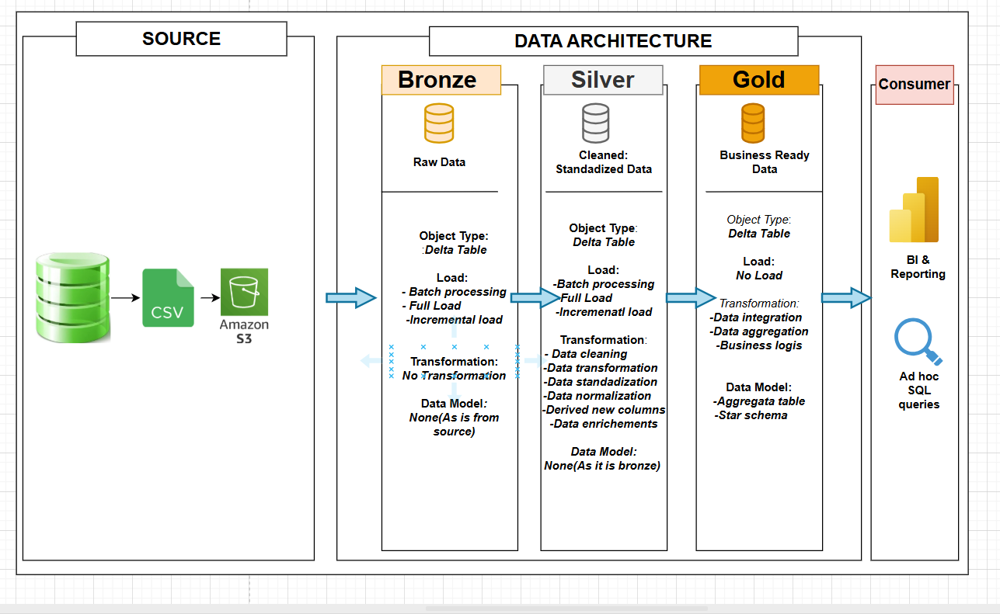
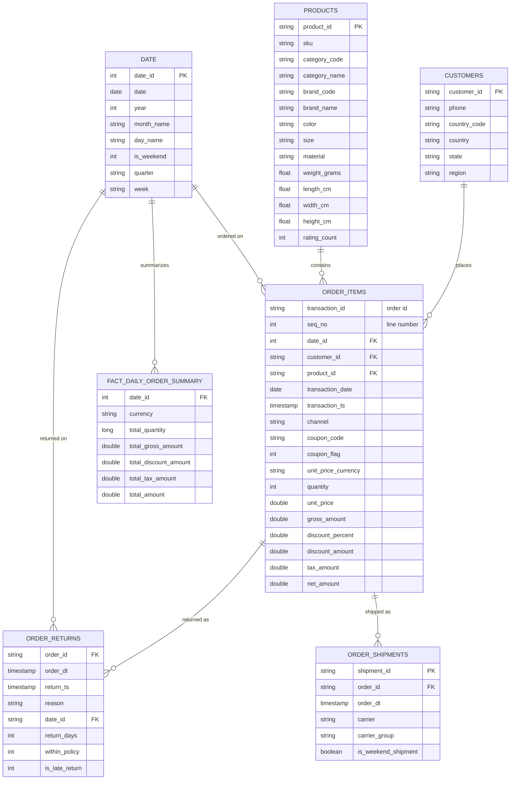

# 🛒 Shopvista Data Engineering Project

An end-to-end data engineering pipeline for **Shopvista**, an ecommerce business, built on **Databricks**, **Delta Lake**, **Unity Catalog**, and **AWS S3**. Raw transactional data is ingested, cleaned, modeled, and served as analytics-ready tables using a **medallion (Bronze → Silver → Gold) architecture**.


---

## 📌 Table of Contents

1. [Project Overview](#-project-overview)
2. [Business Problem](#-business-problem)
3. [Architecture](#-architecture)
4. [Tech Stack](#-tech-stack)
5. [Dataset](#-dataset)
6. [Pipeline Layers](#-pipeline-layers)
7. [Data Model](#-data-model)
8. [Repository Structure](#-repository-structure)
9. [Getting Started](#-getting-started)
10. [Key Insights](#-key-insights)
11. [Challenges & Learnings](#-challenges--learnings)
12. [Future Improvements](#-future-improvements)
13. [Author](#-author)

---

## 🎯 Project Overview

This project simulates a real-world data engineering workflow: taking raw ecommerce CSV extracts, landing them in cloud storage, and transforming them through governed, version-controlled Delta tables so analysts can answer business questions with simple SQL.

**What it demonstrates**

- Cloud storage ingestion from AWS S3 into Databricks
- Medallion architecture with Delta Lake
- Data governance using Unity Catalog (catalogs, schemas, external locations)
- Data cleaning, standardization, and validation in PySpark / Spark SQL
- Dimensional modeling for analytics

---

## 💼 Business Problem

Shopvista's data lives in separate raw files, which makes it hard to answer questions like:

- How are sales, orders, and revenue trending day by day?
- Which products and customer segments drive the most revenue?
- How do returns and shipping performance affect the business?

This pipeline consolidates those files into a single trusted source of truth.

---

## 🏗 Architecture



Raw CSV files land in AWS S3, are ingested into **Bronze** Delta tables, cleaned and conformed in **Silver**, and modeled into analytics-ready **Gold** tables, all governed through Unity Catalog. Dimension and fact tables are processed in separate notebook streams, and a final notebook builds the daily summary table.

---

## 🧰 Tech Stack

| Category | Tools |
|---|---|
| Platform | Databricks |
| Storage | AWS S3 |
| Table Format | Delta Lake |
| Governance | Unity Catalog |
| Processing | PySpark, Spark SQL |
| Language | Python, SQL |
| Version Control | Git / GitHub |

---

## 📂 Dataset

Shopvista ecommerce data delivered as raw files and split into **dimension** and **fact** sources:

| Type | Table | Description |
|---|---|---|
| Dimension | `customers` | Customer profile, country, state, phone |
| Dimension | `products` | Product catalog: SKU, color, size, material, dimensions, rating count |
| Dimension | `brands` | Brand names and codes, linked to a category |
| Dimension | `category` | Product category names and codes |
| Dimension | `date` | Calendar attributes: year, quarter, week, day name |
| Fact | `order_items` | Line-level order items: quantity, price, discount, tax, channel, coupon |
| Fact | `order_returns` | Returned orders with return timestamp and reason |
| Fact | `order_shipments` | Shipments with carrier and order date |
| Generated | `db_date` | Monthly calendar (Jan 2024 to Aug 2025) generated in Spark with month, quarter, and year-quarter attributes |

The raw data is intentionally messy (mixed formats, typos, nulls, duplicates), which is what the Silver layer is built to handle.

---

## 🔄 Pipeline Layers

All layers are written as **Delta tables** registered in Unity Catalog, with **Change Data Feed** enabled. Notebooks are parameterized with Databricks widgets (`catalog`, source table names) so the same logic can be reused across environments.

### 🥉 Bronze: Raw Ingestion

Raw CSV files in S3 (`s3://shopvista-sv/`) are loaded into Bronze Delta tables with no business changes. Every table gets lineage columns (`read_timestamp`, `file_name`, `file_path`) from Spark's `_metadata`.

- **Dimensions** (`brands`, `category`, `customers`, `date`, `products`): read from their S3 folders using explicit `StructType` schemas where possible. In `products`, `weight_grams` and `length_cm` are deliberately read as strings because the source values contain anomalies that Silver cleans up.
- **Generated calendar** (`db_date`): a monthly date table built with Spark SQL `sequence()` and enriched with `date_key`, `month_name`, `quarter`, and `year_quarter`.
- **Facts** (`order_items`, `order_returns`, `order_shipments`): files arrive in an S3 `landing/` folder, are loaded into Bronze, then moved to a `processed/` folder so the same file is never picked up twice.

### 🥈 Silver: Cleaned & Conformed

Each table is profiled first (null counts, duplicate checks), then cleaned:

| Table | Cleaning applied |
|---|---|
| `brands` | Trimmed names; stripped non-alphanumeric characters from `brand_code`; corrected wrong category codes (`GROCERY→GRCY`, `BOOKS→BKS`, `TOYS→TOY`) |
| `category` | Removed duplicate category codes; standardized codes to uppercase |
| `customers` | Dropped rows with null `customer_id`; filled missing phone numbers with a placeholder |
| `date` | Removed duplicate dates; fixed day name casing; converted negative week numbers to positive; built readable quarter (`Q1-2024`) and week (`Week12-2024`) labels |
| `products` | Filled missing colors; removed `g` suffix from weight and cast to float; converted comma decimals in `length_cm`; fixed material typos (`Coton`, `Alumium`, `Ruber`); converted negative rating counts to positive and nulls to 0 |
| `order_items` | Converted text quantities (`"Two"` → 2); stripped `$` from prices and `%` from discounts; mapped channels (`web→Website`, `app→Mobile`); standardized coupon codes; added `processed_time` |
| `order_returns` | Converted `order_dt` to timestamp; trimmed and uppercased `reason`; added `processed_time` |
| `order_shipments` | Converted `order_dt` to timestamp; trimmed and uppercased `carrier`; added `processed_time` |

### 🥇 Gold: Analytics-Ready

Business logic and enrichment that analysts and BI tools can use directly:

| Table | Enrichment |
|---|---|
| `customers` | Added a `region` column by mapping country and state codes across 7 countries (India, Australia, UK, US, UAE, Singapore, Canada); unmapped values default to `other` |
| `products` | Joined products with brands and categories to add `brand_name` and `category_name`, with `Not Available` fallbacks |
| `date` | Added integer `date_id` (`yyyyMMdd`), `month_name`, and `is_weekend` flag |
| `order_items` | Calculated `gross_amount`, `discount_amount`, and `net_amount` (gross minus discount plus tax); added `date_id` and `coupon_flag`; renamed columns to business-friendly names |
| `order_returns` | Calculated `return_days`; added `within_policy` (15-day window) and `is_late_return` flags |
| `order_shipments` | Added `carrier_group` (Domestic vs International) and `is_weekend_shipment` flag |

### 📅 Daily Summary

`daily_summary.ipynb` builds the Gold table `fact_daily_order_summary` from `order_items`, grouped by `date_id` and `currency`:

- Metrics: total quantity, gross amount, discount amount, tax amount, and net amount
- **Incremental logic:** the first run loads full history; later runs recalculate only the last 30 days and **MERGE** (upsert) them into the existing table, updating matching dates and inserting new ones
- The table uses Delta **automatic liquid clustering** (`CLUSTER BY AUTO`) for faster queries

---

## 🗺 Data Model

A star-schema style model in the Gold layer. `order_items` is the central fact table, linked to the customer, product, and date dimensions. Brand and category details are joined into `products` during Gold processing.



**Notes**
- `order_items` has one row per order line, identified by `transaction_id` + `seq_no`
- `order_returns` and `order_shipments` link to `order_items` through the order id
- `fact_daily_order_summary` is keyed by `date_id` + `currency`

---

## 📁 Repository Structure

```
shopvista-e-commerce-Data-Engineering-Project-_aws_databricks/
│
├── 1_setup/                          # Unity Catalog, schemas & external location setup
│
├── 2_dim_bronze_processing.ipynb     # Dimensions: raw ingestion
├── 2_dim_silver_processing.ipynb     # Dimensions: cleaning & conforming
├── 2_dim_gold_processing.ipynb       # Dimensions: analytics-ready tables
│
├── 3_fact_bronze_processing.ipynb    # Facts: raw ingestion
├── 3_fact_silver_processing.ipynb    # Facts: cleaning & conforming
├── 3_fact_gold_processing.ipynb      # Facts: analytics-ready tables
│
├── daily_summary.ipynb               # Daily aggregated sales metrics
│
├── architecture.png                  # Architecture diagram
├── architecture.drawio               # Editable diagram source
└── README.md
```

Notebooks are numbered in execution order: **setup → dimensions → facts → daily summary**.

---

## 🚀 Getting Started

### Prerequisites
- A Databricks workspace (Free Edition works)
- An AWS account with an S3 bucket
- An IAM role / storage credential that gives Databricks access to the bucket
- Unity Catalog enabled

### Setup

1. **Clone the repository**
   ```bash
   git clone https://github.com/OlayinkaEkundayo01/shopvista-e-commerce-Data-Engineering-Project-_aws_databricks.git
   ```
2. **Upload the CSV files** to your S3 bucket (e.g. `s3://<your-bucket>/shopvista/raw/`).
3. **Configure Unity Catalog**: create a storage credential, an external location pointing to your bucket, then a catalog and schemas:
   ```sql
   CREATE CATALOG IF NOT EXISTS shopvista;
   CREATE SCHEMA IF NOT EXISTS shopvista.bronze;
   CREATE SCHEMA IF NOT EXISTS shopvista.silver;
   CREATE SCHEMA IF NOT EXISTS shopvista.gold;
   ```
4. **Import the notebooks** into your Databricks workspace.
5. **Run in order:**
   1. `1_setup/`
   2. `2_dim_bronze` → `2_dim_silver` → `2_dim_gold`
   3. `3_fact_bronze` → `3_fact_silver` → `3_fact_gold`
   4. `daily_summary`

---

## 📊 Key Insights

Findings from the Gold table `fact_daily_order_summary` (August 2025: 31 days across 7 currencies). Amounts are in each currency's local units and are not converted, which is why the summary is grouped by currency.

| Currency | Units Sold | Net Amount | Discount Rate |
|---|---|---|---|
| INR | 46,684 | 612.59M | 8.6% |
| USD | 9,856 | 1.51M | 8.8% |
| GBP | 8,450 | 1.18M | 8.5% |
| AED | 5,810 | 3.14M | 9.0% |
| SGD | 4,975 | 1.17M | 8.7% |
| AUD | 4,438 | 1.16M | 8.7% |
| CAD | 4,395 | 0.95M | 8.9% |

- 🛍 **84,608 units** sold in the month, averaging about **2,730 units per day**
- 🇮🇳 **INR accounts for 55% of all units**, making India the largest market, followed by the US (12%) and the UK (10%)
- 📅 **Weekends sell about 33% more units** than weekdays (Sunday averages ~3,440 units, Saturday ~3,160, while Tuesday is the slowest at ~2,240)
- 🔝 **Peak day was 30 August** with 4,848 units; the slowest was 26 August with 1,652
- 🏷 **Discounts are consistent** at roughly 8.5% to 9.0% of gross sales in every currency, and tax adds about 10% to 10.5%
- ✅ **Reconciliation holds:** for every row, `total_amount = gross − discount + tax`

---

## 🧠 Challenges & Learnings

- **Messy source data:** handled mixed formats (`"Two"` for quantity, `$` and `%` symbols, comma decimals, unit suffixes) and spelling errors without losing rows
- **Secure cloud access:** configured Databricks access to S3 through Unity Catalog external locations
- **Reusable design:** parameterized notebooks with widgets and separated dimension and fact processing
- **Business logic in Gold:** built regional mapping, return policy compliance, and carrier grouping so analysts do not have to repeat that logic

## 🔮 Future Improvements

- [ ] Automate the pipeline with Databricks Workflows / Jobs
- [ ] Move fact tables to incremental loading (append or MERGE) across Bronze, Silver, and Gold, or use Auto Loader
- [ ] Add automated data quality checks
- [ ] Build a dashboard on top of the Gold layer
- [ ] Add CI/CD for notebook deployment

---

## 👤 Author

**Olayinka**
Data Engineer

🔗 [LinkedIn](https://www.linkedin.com/in/olayinka-ekundayo-3b149094) · 💻 [GitHub](https://github.com/OlayinkaEkundayo01) · 📧 olayinkaekundayo2@gmail.com

---

⭐ If you found this project useful, consider giving it a star!
